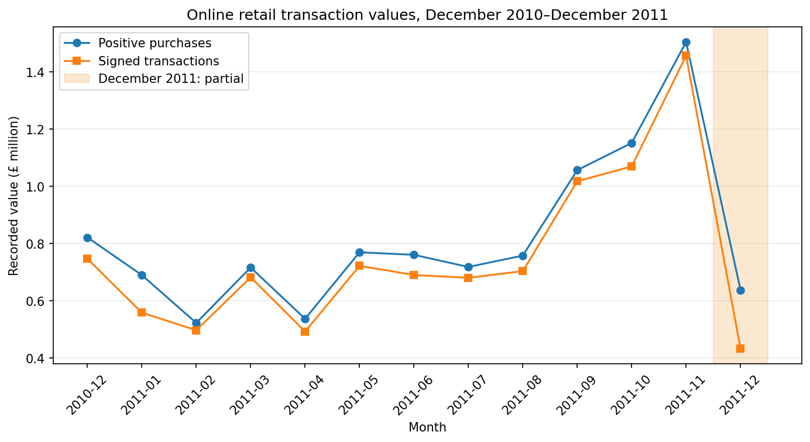
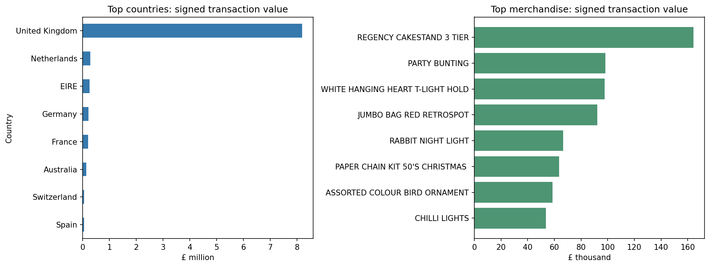

# Online Retail Sales Analysis

Python portfolio project by **Baron Kyaw**: analyse a real retail dataset, document data quality, compare purchase and signed transaction values, and produce reproducible charts and customer summaries.

## Result

See [FINDINGS.md](FINDINGS.md) for measured results and limitations. An important finding is that a large order was cancelled shortly afterwards; signed product rankings avoid counting it as a successful sale.

## Run

1. Download this repository and open a terminal in its folder.
2. Create a virtual environment: `python -m venv .venv`.
3. Activate it on macOS: `source .venv/bin/activate`.
4. Install dependencies: `python -m pip install -r requirements.txt`.
5. Start Jupyter: `jupyter notebook`.
6. Open `Online_Retail_Sales_Analysis.ipynb`, then restart the kernel and run all cells.

Keep `data/Online_Retail.xlsx` beside the notebook in the indicated data folder. Cells write CSVs, a JSON summary and PNG charts into `outputs/`. The notebook includes actual execution outputs. Tested analysis versions: Python 3.12.14, pandas 2.2.3, NumPy 2.3.5, Matplotlib 3.10.8, openpyxl 3.1.5. Code was executed sequentially in a fresh Python namespace; the Jupyter browser interface was not tested.

## Methods

- Audit missing values and duplicates; preserve the original dataset.
- Remove exact duplicate rows under a stated assumption.
- Retain missing customer IDs for transaction totals; exclude them only from customer summaries.
- Compare positive purchase value with signed quantity × price, which includes negative recorded quantities.
- Exclude explicit service/adjustment codes only from merchandise rankings.
- Separate the incomplete December 2011 from complete-month comparisons.
- Calculate recency, distinct-invoice frequency and positive monetary value for known customers.
- Validate row reconciliation and independently grouped totals with 11 assertions.

No profit or causal claim is made. Negative rows need not all match a purchase in this observation window. Customer metrics use positive purchases and can include subsequently cancelled orders.

## Data and attribution

Chen, D. (2015). *Online Retail*. UCI Machine Learning Repository. https://doi.org/10.24432/C5BW33

Source: https://archive.ics.uci.edu/dataset/352/online+retail

Dataset licensed **Creative Commons Attribution 4.0**: https://creativecommons.org/licenses/by/4.0/

The source spreadsheet is redistributed unchanged except its filename. CSVs and charts are derived from it with the transformations described above. This dataset covers December 2010–December 2011, not current market conditions. Dataset licensing applies to the data; no separate code licence has been selected.

## Learning and assistance

This is a new practice project connected to my interest in Big Data analysis, developed with AI assistance. It is not presented as a previously submitted coursework assignment. [LEARNING_GUIDE.md](LEARNING_GUIDE.md) explains the code and suggests exercises to complete before describing the project in an interview.
